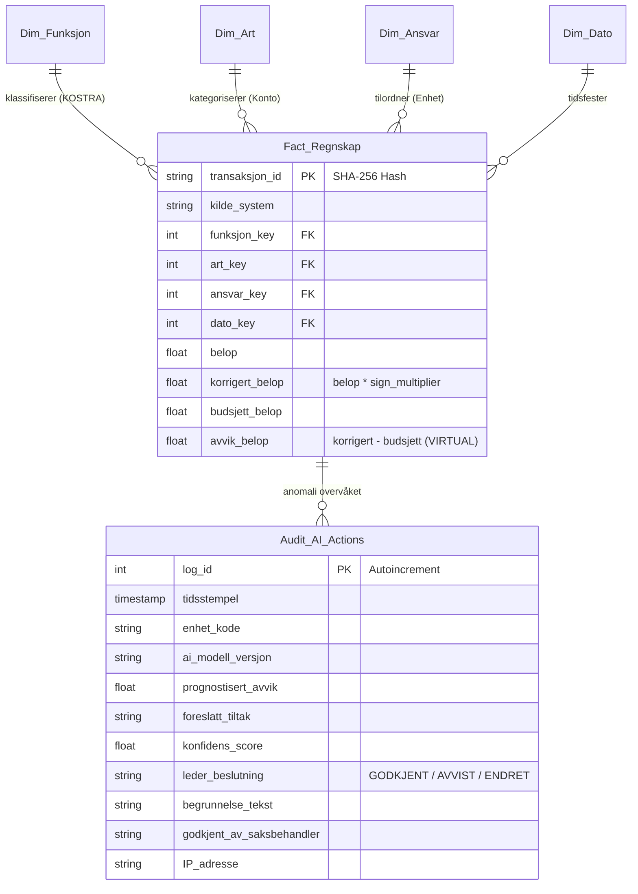

# Kristiansand EPM & Responsible AI Framework
### Kanonisk Datamodell, Multi-Agent EPM Analytics & Ansvarlig AI-Styring (Human-in-the-Loop)

[](https://www.python.org/)
[](https://sqlite.org/)
[](https://powerbi.microsoft.com/)
[](https://www.ssb.no/kostra)
[](https://lovdata.no/lov/2018-06-22-83)

---

## 1. Executive Summary & Bakgrunn


Dette repositoriet implementerer **Antigravity EPM Framework** for proaktiv økonomistyring i **Kristiansand kommune**. 

Løsningen transformerer kommunal virksomhetsstyring fra tradisjonell, tilbakeskuende tertialrapportering (reaktiv kontroll) til en **kontinuerlig, agentbasert tidligvarsling og beslutningsstøtte (60–90 dager før tertialslutt)**, forankret i to representative kommunale enheter:

1. **Kommunal Skole (Oppvekstsektoren, KOSTRA 202):** Rammestyrt enhet med undervisningsplikt, assistenttimer, enkeltvedtak og sesongmessige vikarutgifter.
2. **Kommunal Boenhet (Helse og mestring, KOSTRA 254):** Døgnkontinuerlig enhet (24/7) med turnuspress, overtid/helgetillegg, eksterne vikarbyråer og ressurskrevende brukere.

---

## 2. Systemarkitektur & Kanonisk Datamodell

Løsningen bygger på en **Single Source of Truth (SSOT)** med et kanonisk stjerne-skjema i **SQLite/DuckDB**, klargjort for direkte konsum via **Power BI / Power Query (M-kode)** og Fabric Lakehouse.



### Nøkkelprinsipper for dataintegritet:
* **Deterministisk SHA-256 transaksjons-ID:** Garanterer 100 % idempotens ved gjentatte ETL-kjøringer fra Visma Enterprise, Agresso og Framsikt.
* **Brutto- og anordningsprinsippet (Kommuneloven § 14-6):** Ingen nettoføring mellom lønnskostnader og NAV-refusjoner; full transaksjonssynlighet.
* **Fortegnsmultiplikator (`sign_multiplier`):** Utgifter lagres positivt (`+1`), refusjoner/inntekter med negativ fortegnskorrigering (`-1`).

---

## 3. Spesialiserte EPM AI-Agenter

Arkitekturen drives av 8 spesialiserte AI-agenter (beskrevet i [`agents/`](agents/)):

| Agent | Rolle & Ansvarsområde | Nøkkelleveranse |
| :--- | :--- | :--- |
| **01. Data Integration & ETL** | Kilde-agnostisk vask, KOSTRA-ontologi og SQLite-last | `build_golden_record.py` |
| **02. BI & DAX Modeler** | Stjerneskjemadesign, KOSTRA-nøkkeltall, ISINSCOPE-matriser og EOY-prognoser | DAX-mål i Power BI & [`dax_kostra_kpi_package.md`](docs/dax_kostra_kpi_package.md) |
| **03. Predictive Anomaly Agent** | Overvåker timelister mot historikk (2,5 std.avvik terskel) | Tidligvarsel (T-60 dager) |
| **04. Prescriptive HITL Agent** | Utarbeider prioritert tiltaksmeny for enhetsledere | Tiltak A, B, C per case |
| **05. Ethics & Governance Gatekeeper** | Sikrer samsvar med EU AI Act, Kommuneloven § 14-5 og HTA § 4 | Stage-Gate validering |
| **06. Executive Ghostwriter** | Forfatter ferdige tertialrapporter og saksfremlegg (Tufte-stil) | Styringsnotater til bystyret |
| **07. Excel & Power BI Expert** | FAST-standard, VertiPaq, Query Folding, Tufte Data-Ink og RLS | Enterprise modeller & Dashboards |
| **08. Multi-Level Stakeholder** | 5-nivås kommunal styringspyramide (Enhetsleder $\rightarrow$ Bystyret) | Målgruppetilpassede rapporter |

---

## 4. Ansvarlig AI & Human-in-the-Loop (HITL)

Systemet etterlever **EU AI Act (Art. 27 FRIA, Art. 4 AI Literacy)**, **GDPR (Art. 35 DPIA)** og **Kommuneloven § 14-5**:

```
[ AI-Anbefaling Generert ] ──> [ Menneskelig Evaluering ] ──> [ Formelt Sign-off ]
           │                              │                            │
           ▼                              ▼                            ▼
  • EOY-prognose & avvik         • Enhetsleder vurderer        • Signert i Framsikt
  • Tiltaksmeny (A, B, C)          konsekvenser for drift      • Logget i Audit Trail
  • Konfidens: 91–96 %           • Partssamarbeid (HTA § 4)    • Saksfremlegg (§ 14-5)
```

* **Ingen autonome vedtak:** AI fungerer utelukkende som rådgivende analytiker.
* **Uutslettelig revisjonsspor:** Tabellen `Audit_AI_Actions` lagrer alle forslag, konfidensgrader, begrunnelser og godkjennende leders identitet og IP-adresse.

---

## 5. Visualiseringsstandarder (Edward Tufte)

Rapportene og spørringene er bygget etter Edward Tuftes **Data-Ink Ratio**:
* Ingen vertikale tabellinjer eller skyggeeffekter.
* Høyrejusterte numeriske kolonner med ensartede desimaler.
* Direkte merking i diagrammer i stedet for fragmenterte fargeforklaringer.
* Mutede bakgrunnsfarger; kun fremhevede varslingsfarger ved aktive avvik.

---

## 6. Mappestruktur

```text
.
├── .agent/skills/              # Agentinstruksjoner brukt av verktøyene i arbeidsområdet
├── agents/                     # Beskrivende spesifikasjoner for de åtte EPM-agentene
├── data/                       # Inndata og kildedokumenter for den aktive pipelinen
├── docs/                       # Teknisk dokumentasjon, vedlegg og referansemateriale
├── artifacts/                  # Lokale, genererte resultater (ignoreres av Git)
│   ├── kristiansand_golden_record.db
│   └── reports/                # Genererte rapporter og diagrammer
├── reports/                    # Sjekkede rapport-/arbeidsbok-snapshots og eksempelgrafikk
├── powerbi/                    # DAX/M-kode, arbeidsbok og Power BI Desktop-prosjekter
├── src/                        # Python-kildekode for ETL, UI og rapportgeneratorer
├── tests/                      # Automatiserte tester
├── kristiansand_epm_rammeverk_norsk/ # Separat norsk rammeverkssnapshot med egen README
├── run_pipeline.py             # CLI for ETL og HITL-grensesnitt
├── hitl_writeback_ui.py        # Kompatibel snarvei til Streamlit-grensesnittet i src/
├── smoke_test.py               # Manuell databasekontroll
├── pyproject.toml              # Prosjektmetadata, avhengigheter og testoppsett
└── README.md
```

`artifacts/` er standard mål for nye resultater. `reports/` og arbeidsboken i
rotkatalogen er eksisterende, sjekkede leveranser og oppdateres ikke automatisk
av generatorene. Den separate `kristiansand_epm_rammeverk_norsk/`-mappen
inneholder overlappende eksempelmateriale; den aktive kjørbare pipelinen bruker
rotkatalogens `src/`, `data/` og `artifacts/`.

---

## 7. Komme i gang (Quickstart)

### Forutsetninger
* Python 3.10 eller nyere.
* Core ETL har **null eksterne avhengigheter** (benytter utelukkende Pythons innebygde standardbibliotek: `sqlite3`, `csv`, `hashlib`, `pathlib`).
* UI, rapportgeneratorer og Excel-modellbygger krever prosjektavhengighetene.

### 0. Konfigurer miljøet
```bash
python -m pip install -e .
cp .env.example .env
```
Installer utviklingsavhengigheter og tester med `python -m pip install -e ".[dev]"`.
`.env` setter opp standardstier for kildedata og genererte artefakter.
Standardmodellen lagrer databasen i `artifacts/kristiansand_golden_record.db`
og rapporter i `artifacts/reports/`.

### 1. Bygg Golden Record SQLite-databasen
```bash
python run_pipeline.py --etl
```
Dette etablerer `artifacts/kristiansand_golden_record.db` med stjernemodellen, konsoliderer data fra begge use cases og genererer analytiske views (`V_Fact_Full`, `V_Avvik_YTD`).

### 2. Kjør Agentisk EPM-Pipeline
```bash
python src/epm_agentic_pipeline.py
```
Dette kjører en simulert multi-agent-analyse, oppdager overtidssveksten i boenheten, foreslår korrigerende tiltak, og logger godkjenningen i `Audit_AI_Actions`.

### 3. Start Human-in-the-Loop (HITL) Web-grensesnitt
```bash
python run_pipeline.py --ui
```
Eller, som direkte Streamlit-start:
```bash
streamlit run hitl_writeback_ui.py
```
Denne kommandoen starter det interaktive webpanelet for enhetsledere og controllere. Her kan man inspisere AI-genererte avviksanalyser, overstyre eller godkjenne foreslåtte tiltak (f.eks. omdisponering av vikarbudsjett), og utføre direkte writeback til `Audit_AI_Actions`-revisjonssporet i SQLite-databasen med fullt etisk og juridisk sporingsvern (EU AI Act Compliance). Databasen og rapporter lagres i `artifacts/`, mens rådata ligger i `data/`.

### 4. Kjør hele arbeidsflyten på en gang
```bash
python run_pipeline.py --all
```
Dette bygger databasen og starter deretter HITL-portalen i samme operasjon.

### 5. Generer Fullstendige Styringsrapporter (PowerPoint, PDF & Grafer)
```bash
python src/generate_charts.py
python src/generate_powerpoint_report.py
python src/generate_pdf_report.py
python src/build_excel_epm_model.py
```
Produserer automatisk:
* `artifacts/reports/Kristiansand_EPM_Status_Prognose_Tiltaksrapport.pptx` (10 lysbilder)
* `artifacts/reports/Kristiansand_EPM_Status_Prognose_Tiltaksrapport.pdf` (6 sider A4 liggende)
* Høyoppløselige visualiseringer i `artifacts/reports/*.png`.
* `artifacts/Kristiansand_EPM_Excel_Modell.xlsx`.


---

## 8. Forfatter & Kontakt

**Frank Ellingsen**  
*Senior Business Intelligence Specialist & Financial Controller*  
Kristiansand, Norge
