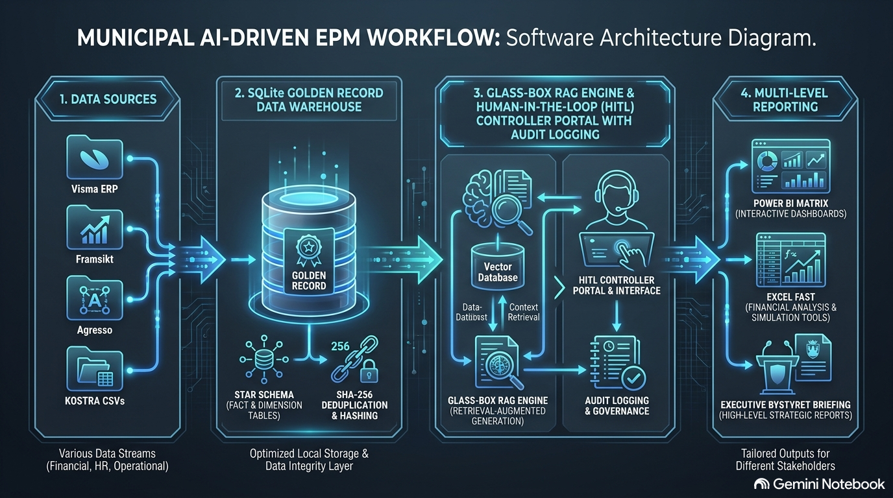
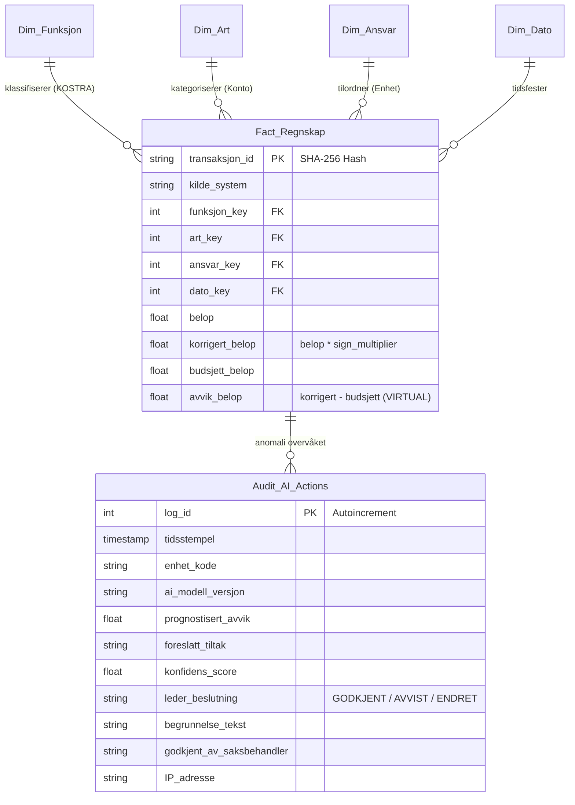

# Kristiansand EPM & Responsible AI Framework
### Kanonisk Datamodell, Multi-Agent EPM Analytics & Ansvarlig AI-Styring (Human-in-the-Loop)

[](https://www.python.org/)
[](https://sqlite.org/)
[](https://powerbi.microsoft.com/)
[](https://www.ssb.no/kostra)
[](https://lovdata.no/lov/2018-06-22-83)

---

## 1. Executive Summary & Bakgrunn



Dette repositoriet implementerer **Antigravity EPM Framework** for proaktiv økonomistyring i **Kristiansand kommune**. 

Løsningen transformerer kommunal virksomhetsstyring fra tradisjonell, tilbakeskuende tertialrapportering (reaktiv kontroll) til en **kontinuerlig, agentbasert tidligvarsling og beslutningsstøtte (60–90 dager før tertialslutt)**, forankret i to representative kommunale enheter:

1. **Kommunal Skole (Oppvekstsektoren):** *Mevold Grunnskole* (`KOSTRA 202`) – Rammestyrt enhet med undervisningsplikt, assistenttimer, enkeltvedtak og sesongmessige vikarutgifter.
2. **Kommunal Boenhet (Helse og mestring):** *Slettheia Bofellesskap* (`KOSTRA 254`) – Døgnkontinuerlig enhet (24/7) med turnuspress, overtid/helgetillegg, eksterne vikarbyråer og ressurskrevende brukere.

---

## 2. Systemarkitektur & Kanonisk Datamodell

Løsningen bygger på en **Single Source of Truth (SSOT)** med et kanonisk stjerne-skjema i **SQLite/DuckDB**, klargjort for direkte konsum via **Power BI / Power Query (M-kode)** og Fabric Lakehouse.



### Nøkkelprinsipper for dataintegritet:
* **Deterministisk SHA-256 transaksjons-ID:** Garanterer 100 % idempotens ved gjentatte ETL-kjøringer fra Visma Enterprise, Agresso og Framsikt.
* **Brutto- og anordningsprinsippet (Kommuneloven § 14-6):** Ingen nettoføring mellom lønnskostnader og NAV-refusjoner; full transaksjonssynlighet.
* **Fortegnsmultiplikator (`sign_multiplier`):** Utgifter lagres positivt (`+1`), refusjoner/inntekter med negativ fortegnskorrigering (`-1`).

---

## 3. Spesialiserte EPM AI-Agenter

Arkitekturen drives av 8 spesialiserte AI-agenter (beskrevet i [`agents/`](agents/)):

| Agent | Rolle & Ansvarsområde | Nøkkelleveranse |
| :--- | :--- | :--- |
| **01. Data Integration & ETL** | Kilde-agnostisk vask, KOSTRA-ontologi og SQLite-last | `build_golden_record.py` |
| **02. BI & DAX Modeler** | Stjerneskjemadesign, ISINSCOPE-matriser og EOY-prognoser | DAX-mål i Power BI |
| **03. Predictive Anomaly Agent** | Overvåker timelister mot historikk (2,5 std.avvik terskel) | Tidligvarsel (T-60 dager) |
| **04. Prescriptive HITL Agent** | Utarbeider prioritert tiltaksmeny for enhetsledere | Tiltak A, B, C per case |
| **05. Ethics & Governance Gatekeeper** | Sikrer samsvar med EU AI Act, Kommuneloven § 14-5 og HTA § 4 | Stage-Gate validering |
| **06. Executive Ghostwriter** | Forfatter ferdige tertialrapporter og saksfremlegg (Tufte-stil) | Styringsnotater til bystyret |
| **07. Excel & Power BI Expert** | FAST-standard, VertiPaq, Query Folding, Tufte Data-Ink og RLS | Enterprise modeller & Dashboards |
| **08. Multi-Level Stakeholder** | 5-nivås kommunal styringspyramide (Enhetsleder $\rightarrow$ Bystyret) | Målgruppetilpassede rapporter |

---

## 4. Ansvarlig AI & Human-in-the-Loop (HITL)

Systemet etterlever **EU AI Act (Art. 27 FRIA, Art. 4 AI Literacy)**, **GDPR (Art. 35 DPIA)** og **Kommuneloven § 14-5**:

```
[ AI-Anbefaling Generert ] ──> [ Menneskelig Evaluering ] ──> [ Formelt Sign-off ]
           │                              │                            │
           ▼                              ▼                            ▼
  • EOY-prognose & avvik         • Enhetsleder vurderer        • Signert i Framsikt
  • Tiltaksmeny (A, B, C)          konsekvenser for drift      • Logget i Audit Trail
  • Konfidens: 91–96 %           • Partssamarbeid (HTA § 4)    • Saksfremlegg (§ 14-5)
```

* **Ingen autonome vedtak:** AI fungerer utelukkende som rådgivende analytiker.
* **Uutslettelig revisjonsspor:** Tabellen `Audit_AI_Actions` lagrer alle forslag, konfidensgrader, begrunnelser og godkjennende leders identitet og IP-adresse.

---

## 5. Visualiseringsstandarder (Edward Tufte)

Rapportene og spørringene er bygget etter Edward Tuftes **Data-Ink Ratio**:
* Ingen vertikale tabellinjer eller skyggeeffekter.
* Høyrejusterte numeriske kolonner med ensartede desimaler.
* Direkte merking i diagrammer i stedet for fragmenterte fargeforklaringer.
* Mutede bakgrunnsfarger; kun fremhevede varslingsfarger ved aktive avvik.

---

## 6. Mappestruktur

```text
.
├── agents/                     # Spesifikasjoner for de 8 spesialiserte EPM AI-agentene
│   ├── 01_data_integration_etl_agent.md
│   ├── 02_bi_dax_modeler_agent.md
│   ├── 03_predictive_anomaly_agent.md
│   ├── 04_prescriptive_hitl_agent.md
│   ├── 05_ethics_governance_gatekeeper_agent.md
│   ├── 06_executive_report_ghostwriter_agent.md
│   ├── 07_excel_powerbi_reporting_expert_agent.md
│   └── 08_multilevel_stakeholder_reporting_agent.md
├── data/                       # Grunnlagsdata og normaliserte regnskapsfiler
│   ├── BoMiljø.csv             # Slettheia Bofellesskap (1 056 rader, 12 mnd)
│   └── Komskole.csv            # Mevold Grunnskole / Åseral (194 rader)
├── docs/                       # Saksfremlegg, rammeverk og referansedokumenter
│   ├── antigravity_usecase_epm.md      # Full teknisk og forretningsmessig spesifikasjon
│   ├── epm_full_workflow_documentation.md # End-to-end arkitekturdokumentasjon for EPM AI-agentene
│   ├── epm_workflow_diagram.png        # Visuelt arbeidsflytdiagram for Kristiansand EPM
│   ├── saksfremlegg_epm_okonomidirektor.docx
│   ├── use_case_kristiansand_kommune-v4.docx
│   └── references/             # Kommunale styringsdokumenter og økonomiplan
│       ├── 1.-tertialrapport-2026---kristiansand-kommune.pdf
│       ├── kommunedirektorens-forslag-til-okonomiplan-2027-2030.pdf
│       ├── okonomireglement-for-kristiansand-kommune.pdf
│       ├── Nøkkeltall _Kristiansand_Kommune.pdf
│       └── Rådgiver økonomistyring Kristiansand Kommune - arbeidsplassen.no.pdf
├── powerbi/                    # Komplett Power BI & Excel Semantic Model-suite
│   ├── 01_PowerQuery_M_Code.pq         # Power Query ETL (CSV & SQLite kilder)
│   ├── 02_DAX_Measures_Library.dax     # YTD, EOY Prognose, Turnus- og Framsikt/Tufte-mål
│   ├── 03_PowerBI_Model_Architecture.md# Relasjonsguide, RLS & Rapportdesign
│   ├── fxOpenAI_RAG.m                  # Power Query M-funksjon for OpenAI RAG-integrasjon
│   ├── generate_excel_powerbi_model.py # Generator for konsolidert arbeidsbok
│   └── Kristiansand_EPM_PowerBI_Model.xlsx # Fullstendig modell for direkte Power BI import
├── reports/                    # Styringsrapporter & Høyoppløselige Visualiseringer
│   ├── Kristiansand_EPM_Status_Prognose_Tiltaksrapport.pptx # Komplett 10-siders PowerPoint i 16:9 widescreen
│   ├── Kristiansand_EPM_Status_Prognose_Tiltaksrapport.pdf  # Formell 6-siders A4 landscape PDF styringsrapport
│   ├── chart_bomiljo_monthly.png       # Månedlig forløp, februarsjokk & Net Zero tiltaksbane
│   ├── chart_komskole_units.png        # Horisontale enhetsavvik for Mevold Skole
│   └── chart_netzero_waterfall.png     # Konsolidert vannfallsdiagram mot Net Zero budsjettbalanse
├── src/                        # Operativ Python-kildekode
│   ├── build_golden_record.py  # Hoved-ETL (100 % Python Standard Library)
│   ├── build_excel_epm_model.py# Generator for master Excel EPM-modell
│   ├── generate_charts.py      # Generator for Tufte-grafer og vannfallsdiagrammer
│   ├── generate_powerpoint_report.py # Generator for 16:9 executive PowerPoint rapport
│   ├── generate_pdf_report.py  # Generator for formell ReportLab PDF styringsrapport
│   ├── epm_agentic_pipeline.py # Multi-agent orkestrering & HITL-logging
│   └── hitl_writeback_ui.py    # Streamlit Human-in-the-Loop Web-UI med SQLite writeback
├── hitl_writeback_ui.py        # Snarvei for Streamlit HITL Portal i rotkatalog
├── Kristiansand_EPM_Excel_Modell.xlsx # Standalone master Excel-modell med dashboards & Tufte-styling
├── .gitignore
├── requirements.txt
└── README.md
```

---

## 7. Komme i gang (Quickstart)

### Forutsetninger
* Python 3.10 eller nyere.
* Core ETL har **null eksterne avhengigheter** (benytter utelukkende Pythons innebygde standardbibliotek: `sqlite3`, `csv`, `hashlib`, `pathlib`).

### 1. Bygg Golden Record SQLite-databasen
```bash
python src/build_golden_record.py
```
Dette etablerer `kristiansand_golden_record.db` med stjernemodellen, konsoliderer 1 250 transaksjoner fra begge use cases og genererer analytiske views (`V_Fact_Full`, `V_Avvik_YTD`).

### 2. Kjør Agentisk EPM-Pipeline
```bash
python src/epm_agentic_pipeline.py
```
Dette kjører en simulert multi-agent-analyse, oppdager overtidssveksten i boenheten, foreslår korrigerende tiltak, og logger godkjenningen i `Audit_AI_Actions`.

### 3. Start Human-in-the-Loop (HITL) Web-grensesnitt
```bash
streamlit run hitl_writeback_ui.py
```
Starter det interaktive webpanelet for enhetsledere og controllere. Her kan man inspisere AI-genererte avviksanalyser, overstyre eller godkjenne foreslåtte tiltak (f.eks. omdisponering av vikarbudsjett), og utføre direkte writeback til `Audit_AI_Actions`-revisjonssporet i SQLite-databasen med fullt etisk og juridisk sporingsvern (EU AI Act Compliance).

### 4. Generer Fullstendige Styringsrapporter (PowerPoint, PDF & Grafer)
```bash
python src/generate_charts.py
python src/generate_powerpoint_report.py
python src/generate_pdf_report.py
```
Produserer automatisk:
* `reports/Kristiansand_EPM_Status_Prognose_Tiltaksrapport.pptx` (10 lysbilder)
* `reports/Kristiansand_EPM_Status_Prognose_Tiltaksrapport.pdf` (6 sider A4 liggende)
* Høyoppløselige visualiseringer i `reports/*.png`.


---

## 8. Forfatter & Kontakt

**Frank Ellingsen**  
*Senior Business Intelligence Specialist & Financial Controller*  
Kristiansand, Norge
